

# 🏗️ botyaraRTS — Buildings

**A practical guide to every structure: stats, production lists and tactics.**

[🇬🇧 English](BUILDINGS_EN.md) | [🇷🇺 Русский](BUILDINGS_RU.md)
[📖 README (EN)](README.md) | [📖 README (RU)](README.ru.md)

---

## 📑 Contents

- [🔨 How to Build](#-how-to-build)
- [🏠 Economy](#-economy) — Headquarters, Supply Depot, Refinery, Plasma Extractor, Trading Post
- [🏭 Production](#-production) — Barracks, Factory, Starport, Spec Ops Lab
- [🛡️ Defense](#%EF%B8%8F-defense) — Turret, SAM Site, Wall, Artillery Bunker, Shield Generator
- [🔬 Research](#-research) — Armory, Engineering Bay

---

## 🔨 How to Build

1. 👷 Select a **Worker**.
2. 📋 Open a construction tab in the bottom panel: **Economy**, **Production**, **Defense** or **Research**.
3. 🖱️ Click the building you want.
4. 🎯 Move the cursor to a location — a **green** preview means valid, **red** means blocked (occupied, wall, water or resource tile).
5. ⬅️ Left-click to place it. The nearest available Worker is dispatched automatically, and resources are deducted immediately.
6. ⏳ Wait for construction. An unfinished building starts at **10% HP** and grows to full HP when complete.

💡 **Tips**
- **Right-click** cancels build mode.
- Hold **`Shift`** while placing to queue several buildings in a row.
- Select a production building and **right-click** the map to set its **rally point** — Workers sent to a resource tile start harvesting automatically.
- Buildings can't be placed on top of other buildings or units.

---

## 🏠 Economy

### 🏰 Headquarters

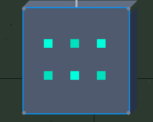

The heart of your base and the starting center of your economy. It stores harvested resources, produces Workers and anchors your supply limit.

| ⚙️ Parameter | 📊 Value |
|---|---|
| 💰 Cost | **400 Titan** |
| ⏱️ Build time | **60 s** |
| ❤️ Durability | **1500 HP** |
| 📐 Size | **3×3 tiles** |
| 👥 Supply | **+15** |
| 📦 Produces | Worker |
| 📥 Accepts resources | ✅ |
| 🔭 Vision | 18 tiles |

The Rally point is auto-set to the nearest Titan deposit at match start, so freshly built Workers walk straight to mining.

🧠 **Tactics** — protect it at all costs: with no Headquarters you can't produce Workers or drop off resources nearby. In desperate situations it's also your only way to rebuild an economy.

---

### 📦 Supply Depot

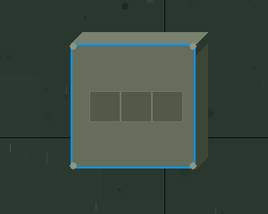

A living block that raises your population cap so you can keep producing units.

| ⚙️ Parameter | 📊 Value |
|---|---|
| 💰 Cost | **100 Titan** |
| ⏱️ Build time | **20 s** |
| ❤️ Durability | **400 HP** |
| 📐 Size | **2×2 tiles** |
| 👥 Supply | **+10** |

🧠 **Tactics** — always build the next Depot **before** you hit the cap (a full supply bar freezes all unit production). The cap tops out at **200** (raiseable to 300 by an upgrade).

---

### 🛢️ Refinery

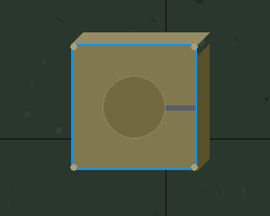

A remote drop-off point that shortens Worker travel time to far-away deposits.

| ⚙️ Parameter | 📊 Value |
|---|---|
| 💰 Cost | **150 Titan** |
| ⏱️ Build time | **25 s** |
| ❤️ Durability | **500 HP** |
| 📐 Size | **2×2 tiles** |
| 📥 Accepts resources | ✅ |

🧠 **Tactics** — the round trip is what limits mining speed. A Refinery next to a neutral Titan patch can boost effective income of those Workers noticeably. It also serves as a forward base for pushing into the middle of the map.

---

### ⚡ Plasma Extractor

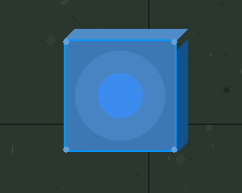

A specialized structure associated with Plasma Geysers.

| ⚙️ Parameter | 📊 Value |
|---|---|
| 💰 Cost | **200 Titan** |
| ⏱️ Build time | **30 s** |
| ❤️ Durability | **600 HP** |
| 📐 Size | **2×2 tiles** |

🧠 **Tactics** — Plasma fuels everything advanced: Factories, Starports, Spec Ops Labs, siege units. Secure a geyser early if your doctrine relies on high-tech forces.

---

### 💱 Trading Post

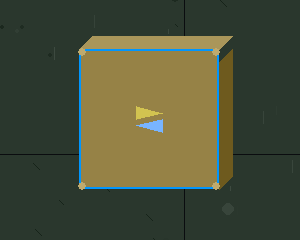

An exchange structure for converting surplus Titan into Plasma.

| ⚙️ Parameter | 📊 Value |
|---|---|
| 💰 Cost | **150 Titan** |
| ⏱️ Build time | **20 s** |
| ❤️ Durability | **350 HP** |
| 📐 Size | **2×2 tiles** |
| 🔁 Exchange rate | **3 Titan → 1 Plasma** |

🧠 **Tactics** — when you're floating Titan but a Factory or Starport is waiting on Plasma, the Trading Post bridges the gap instead of idling your production.

---

## 🏭 Production

### 🪖 Barracks

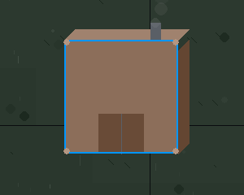

Trains all infantry. Your first combat building in almost every opening.

| ⚙️ Parameter | 📊 Value |
|---|---|
| 💰 Cost | **200 Titan** |
| ⏱️ Build time | **35 s** |
| ❤️ Durability | **800 HP** |
| 📐 Size | **2×2 tiles** |
| 📦 Produces | Scout · Trooper · Sniper · Rocket Soldier · Medic · Exo Soldier |

🧠 **Tactics** — one Barracks sustains early pressure and map control; two or three back the **Swarm** and **Early Rush** doctrines. Set the rally point on a watch spot, not on the floor.

---

### 🏭 Factory

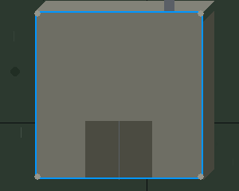

Heavy industry for ground vehicles — the backbone of mid-game pushes.

| ⚙️ Parameter | 📊 Value |
|---|---|
| 💰 Cost | **300 Titan + 50 Plasma** |
| ⏱️ Build time | **45 s** |
| ❤️ Durability | **1200 HP** |
| 📐 Size | **3×3 tiles** |
| 📦 Produces | Buggy · Tank · Flamethrower · Siege Tank · Mobile AA · Mech Walker |

🧠 **Tactics** — Factories are expensive and Plasma-hungry: stabilize your economy first. Tanks + Siege Tanks power the **Siege Push** doctrine; Mech Walkers are your late-game heavy hitters.

---

### 🚀 Starport

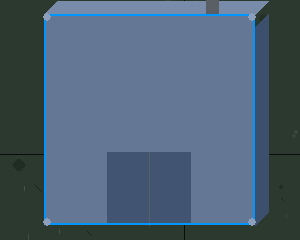

Airfield for aircraft — mobility, map vision and strikes where ground armies can't reach.

| ⚙️ Parameter | 📊 Value |
|---|---|
| 💰 Cost | **350 Titan + 100 Plasma** |
| ⏱️ Build time | **50 s** |
| ❤️ Durability | **1000 HP** |
| 📐 Size | **3×3 tiles** |
| 📦 Produces | Scout Drone · Attack Helicopter · Fighter · Bomber · Transport |

🧠 **Tactics** — the core of the **Air Force** doctrine (build two or three of them). Aircraft ignore terrain, so they excel at harassing miners and sniping undefended expansion structures — but watch out for enemy SAM Sites.

---

### 🕵️ Spec Ops Lab

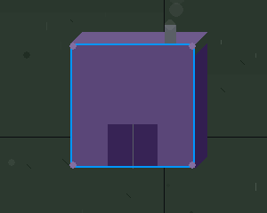

Secret facility for exotic units and precise strikes on high-value targets.

| ⚙️ Parameter | 📊 Value |
|---|---|
| 💰 Cost | **250 Titan + 100 Plasma** |
| ⏱️ Build time | **40 s** |
| ❤️ Durability | **700 HP** |
| 📐 Size | **2×2 tiles** |
| 📦 Produces | Saboteur · Psi Unit · Mine Drone · Super Unit «Punisher» |

🧠 **Tactics** — the heart of the **Tech** doctrine: Saboteurs delete key buildings, Psi Units steal enemy units, and the «Punisher» is a walking fortress that wins late games. Protect the Lab — it's a priority target for your opponent.

---

## 🛡️ Defense

### 🔫 Turret

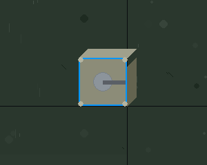

Automatic gun emplacement — its barrel visually tracks the current target.

| ⚙️ Parameter | 📊 Value |
|---|---|
| 💰 Cost | **100 Titan** |
| ⏱️ Build time | **15 s** |
| ❤️ Durability | **300 HP** |
| 📐 Size | **1×1 tile** |
| 💥 Damage | **15** (ground + air) |
| 🎯 Range | **192 px** |

🧠 **Tactics** — the cheapest way to hold territory. Place around resource patches, chokepoints and production buildings; the **Fortress** doctrine stacks up to six of them and dares the enemy to come.

---

### 🚀 SAM Site

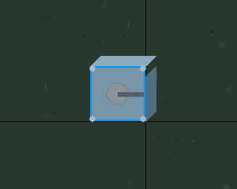

Dedicated anti-air battery with a detector for cloaked targets.

| ⚙️ Parameter | 📊 Value |
|---|---|
| 💰 Cost | **120 Titan** |
| ⏱️ Build time | **20 s** |
| ❤️ Durability | **250 HP** |
| 📐 Size | **1×1 tile** |
| 💥 Damage | **30** (air only) |
| 🎯 Range | **256 px** |
| 🔍 Detector | ✅ |

🧠 **Tactics** — a Turret can't efficiently fight aircraft; a SAM can't shoot ground at all. Mix them. One SAM per base neutralizes early air harassment completely.

---

### 🧱 Wall

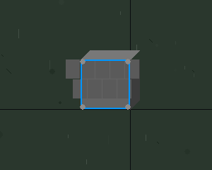

A cheap barricade for shaping enemy movement and buying time.

| ⚙️ Parameter | 📊 Value |
|---|---|
| 💰 Cost | **25 Titan** |
| ⏱️ Build time | **5 s** |
| ❤️ Durability | **500 HP** |
| 📐 Size | **1×1 tile** |

🧠 **Tactics** — walls don't shoot; walls make enemies *stand* where your Turrets and Artillery Bunkers already aim. Wall off a chokepoint and the fight happens on your terms.

---

### 💣 Artillery Bunker

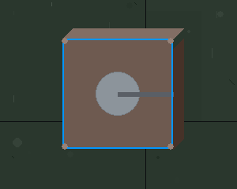

Long-range howitzer emplacement with heavy per-shot damage.

| ⚙️ Parameter | 📊 Value |
|---|---|
| 💰 Cost | **250 Titan + 50 Plasma** |
| ⏱️ Build time | **35 s** |
| ❤️ Durability | **600 HP** |
| 📐 Size | **2×2 tiles** |
| 💥 Damage | **40** |
| 🎯 Range | **384 px** (2× Turret range) |

🧠 **Tactics** — the anchor of static defense: hide it behind a Wall line so it survives the first contact, and its range does the rest. Also great for covering narrow map corridors.

---

### 🔵 Shield Generator

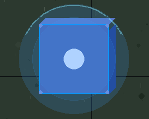

Projects a regenerating energy barrier to absorb damage before HP.

| ⚙️ Parameter | 📊 Value |
|---|---|
| 💰 Cost | **200 Titan + 100 Plasma** |
| ⏱️ Build time | **40 s** |
| ❤️ Durability | **500 HP** |
| 🛡️ Shield | **1000** (regen 10/s) |
| 📐 Size | **2×2 tiles** |
| 📡 Field radius | **192 px** |

🧠 **Tactics** — effective HP multiplier for a defensive cluster. Place it centrally among Turrets and Bunkers so the field covers as many structures as possible, and remember the shield regenerates for free between fights.

---

## 🔬 Research

> ⚠️ **Note** — Armory and Engineering Bay are reserved for the upcoming weapon/armor upgrade system. Build them for the vision and structure they provide today; research arrives in a future update.

### ⚒️ Armory

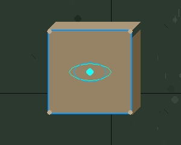

Infantry research center (future weapon & armor upgrades).

| ⚙️ Parameter | 📊 Value |
|---|---|
| 💰 Cost | **200 Titan + 50 Plasma** |
| ⏱️ Build time | **30 s** |
| ❤️ Durability | **600 HP** |
| 📐 Size | **2×2 tiles** |

### 🔧 Engineering Bay

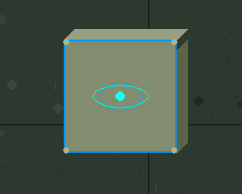

Vehicle research center (future vehicle upgrades).

| ⚙️ Parameter | 📊 Value |
|---|---|
| 💰 Cost | **200 Titan + 75 Plasma** |
| ⏱️ Build time | **30 s** |
| ❤️ Durability | **600 HP** |
| 📐 Size | **2×2 tiles** |

---

**[⬆ Back to top](#-contents)** ·
[📖 README (EN)](README.md) · [📖 README (RU)](README.ru.md) ·
[🇬🇧 English](BUILDINGS_EN.md) | [🇷🇺 Русский](BUILDINGS_RU.md)

