

# 🏗️ botyaraRTS — Здания

**Практический справочник по всем постройкам: характеристики, производство и тактика.**

[🇷🇺 Русский](BUILDINGS_RU.md) | [🇬🇧 English](BUILDINGS_EN.md)
[📖 README (RU)](README.ru.md) | [📖 README (EN)](README.md)

---

## 📑 Содержание

- [🔨 Как строить](#-как-строить)
- [🏠 Экономика](#-экономика) — Штаб, Жилой блок, Склад, Экстрактор плазмы, Торговый пост
- [🏭 Производство](#-производство) — Казармы, Завод, Космопорт, Лаборатория
- [🛡️ Оборона](#%EF%B8%8F-оборона) — Турель, ПВО, Стена, Артиллерийский бункер, Генератор щита
- [🔬 Исследования](#-исследования) — Арсенал, Инженерный корпус

---

## 🔨 Как строить

1. 👷 Выделите **рабочего**.
2. 📋 Откройте вкладку строительства в нижней панели: **Экономика**, **Производство**, **Оборона** или **Исследования**.
3. 🖱️ Щёлкните нужное здание.
4. 🎯 Наведите курсор на место — **зелёное** превью значит «можно строить», **красное** — нельзя (занято, скала, вода или ресурс).
5. ⬅️ ЛКМ — поставить здание. Ближайший свободный рабочий отправится автоматически, ресурсы спишутся сразу.
6. ⏳ Дождитесь стройки. Недостроенное здание начинает с **10% HP** и вырастает до полного.

💡 **Советы**
- **ПКМ** отменяет режим стройки.
- Держите **`Shift`**, чтобы ставить несколько зданий подряд.
- Выделите производственное здание и **ПКМ** по карте — установить **точку сбора**; рабочего, отправленного на ресурсный тайл, сразу начинает добывать.
- Строить поверх других зданий и юнитов нельзя.

---

## 🏠 Экономика

### 🏰 Штаб (Headquarters)

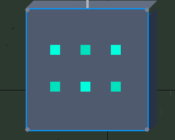

Сердце базы и центр вашей экономики: хранит добычу, производит рабочих и держит лимит населения.

| ⚙️ Параметр | 📊 Значение |
|---|---|
| 💰 Стоимость | **400 титана** |
| ⏱️ Время стройки | **60 с** |
| ❤️ Прочность | **1500 HP** |
| 📐 Размер | **3×3 тайла** |
| 👥 Население | **+15** |
| 📦 Производит | Рабочий |
| 📥 Принимает ресурсы | ✅ |
| 🔭 Обзор | 18 тайлов |

Точка сбора Штаба автоматически ставится на ближайшее месторождение титана — свежие рабочие сразу идут добывать.

🧠 **Тактика** — берегите Штаб: без него нельзя производить рабочих и некуда сдавать ресурсы. В отчаянной ситуации это единственный способ отстроить экономику заново.

---

### 📦 Жилой блок (Supply Depot)

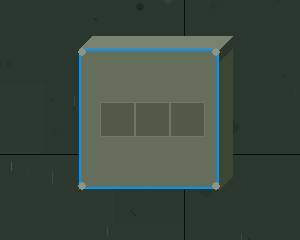

Повышает лимит населения, чтобы производство юнитов не останавливалось.

| ⚙️ Параметр | 📊 Значение |
|---|---|
| 💰 Стоимость | **100 титана** |
| ⏱️ Время стройки | **20 с** |
| ❤️ Прочность | **400 HP** |
| 📐 Размер | **2×2 тайла** |
| 👥 Население | **+10** |

🧠 **Тактика** — стройте следующий блок **до** того, как упрётесь в лимит (полная полоса населения замораживает производство юнитов). Потолок — **200** (улучшением поднимается до 300).

---

### 🛢️ Склад (Refinery)

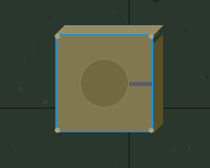

Удалённый пункт сдачи ресурсов — сокращает путь рабочих к дальним месторождениям.

| ⚙️ Параметр | 📊 Значение |
|---|---|
| 💰 Стоимость | **150 титана** |
| ⏱️ Время стройки | **25 с** |
| ❤️ Прочность | **500 HP** |
| 📐 Размер | **2×2 тайла** |
| 📥 Принимает ресурсы | ✅ |

🧠 **Тактика** — скорость добычи ограничивает именно дорога туда-обратно. Склад у нейтрального месторождения ощутимо повышает доход рабочих на флангах. Заодно это передовой узел для захвата центра карты.

---

### ⚡ Экстрактор плазмы (Plasma Extractor)

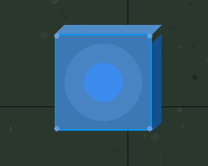

Специализированная постройка, связанная с гейзерами плазмы.

| ⚙️ Параметр | 📊 Значение |
|---|---|
| 💰 Стоимость | **200 титана** |
| ⏱️ Время стройки | **30 с** |
| ❤️ Прочность | **600 HP** |
| 📐 Размер | **2×2 тайла** |

🧠 **Тактика** — плазма питает всё продвинутое: Заводы, Космопорты, Лаборатории, осадные юниты. Если ваша доктрина держится на хай-теке — займите гейзер пораньше.

---

### 💱 Торговый пост (Trading Post)

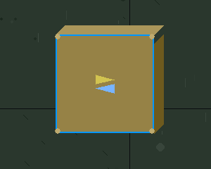

Обменник: превращает излишки титана в плазму.

| ⚙️ Параметр | 📊 Значение |
|---|---|
| 💰 Стоимость | **150 титана** |
| ⏱️ Время стройки | **20 с** |
| ❤️ Прочность | **350 HP** |
| 📐 Размер | **2×2 тайла** |
| 🔁 Курс обмена | **3 титана → 1 плазма** |

🧠 **Тактика** — титан капает, а Завод ждёт плазму? Торговый пост закрывает разрыв, пока производство не простаивает.

---

## 🏭 Производство

### 🪖 Казармы (Barracks)

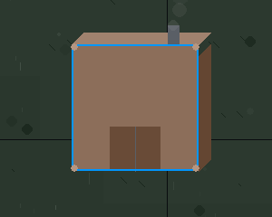

Готовят всю пехоту — первое боевое здание почти в любом открытии.

| ⚙️ Параметр | 📊 Значение |
|---|---|
| 💰 Стоимость | **200 титана** |
| ⏱️ Время стройки | **35 с** |
| ❤️ Прочность | **800 HP** |
| 📐 Размер | **2×2 тайла** |
| 📦 Производит | Разведчик · Пехотинец · Снайпер · Ракетчик · Медик · Экзо-солдат |

🧠 **Тактика** — одна Казарма держит раннее давление и контроль карты; две-три качают доктрины **«Рой»** и **«Ранняя атака»**. Точку сбора ставьте на наблюдательную позицию, а не «в пол».

---

### 🏭 Завод (Factory)

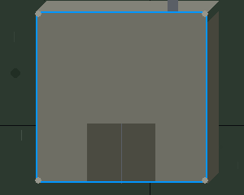

Тяжёлая промышленность для наземной техники — хребет мидгейма.

| ⚙️ Параметр | 📊 Значение |
|---|---|
| 💰 Стоимость | **300 титана + 50 плазмы** |
| ⏱️ Время стройки | **45 с** |
| ❤️ Прочность | **1200 HP** |
| 📐 Размер | **3×3 тайла** |
| 📦 Производит | Багги · Танк · Огнемётчик · Осадный танк · Мобильная ПВО · Мех-ходун |

🧠 **Тактика** — Завод дорог и прожорлив до плазмы: сначала стабилизируйте экономику. Танки и осадные танки — ядро доктрины **«Осада»**, мех-ходуны — тяжёлая артиллерия поздней игры.

---

### 🚀 Космопорт (Starport)

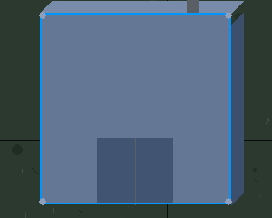

Аэродром авиации: мобильность, обзор карты и удары туда, куда наземная армия не дойдёт.

| ⚙️ Параметр | 📊 Значение |
|---|---|
| 💰 Стоимость | **350 титана + 100 плазмы** |
| ⏱️ Время стройки | **50 с** |
| ❤️ Прочность | **1000 HP** |
| 📐 Размер | **3×3 тайла** |
| 📦 Производит | Дрон-разведчик · Атакующий вертолёт · Истребитель · Бомбардировщик · Транспорт |

🧠 **Тактика** — сердце доктрины **«Только авиация»** (стройте два-три). Авиация игнорирует рельеф — идеально для атак на шахтёров и сноса фланговых построек, но берегитесь ПВО противника.

---

### 🕵️ Лаборатория спецопераций (Spec Ops Lab)

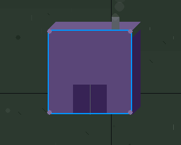

Секретный объект для экзотических юнитов и точечных ударов по важным целям.

| ⚙️ Параметр | 📊 Значение |
|---|---|
| 💰 Стоимость | **250 титана + 100 плазмы** |
| ⏱️ Время стройки | **40 с** |
| ❤️ Прочность | **700 HP** |
| 📐 Размер | **2×2 тайла** |
| 📦 Производит | Диверсант · Пси-юнит · Минный дрон · Суперюнит «Кара» |

🧠 **Тактика** — сердце доктрины **«Технарь»**: диверсанты сносят ключевые здания, пси-юниты перехватывают чужие войска, а «Кара» — ходячая крепость, решающая позднюю игру. Охраняйте Лабораторию — противник метит в неё первым делом.

---

## 🛡️ Оборона

### 🔫 Турель (Turret)

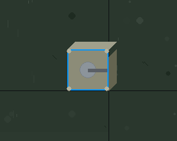

Автоматическая пушка — её ствол визуально доворачивается к текущей цели.

| ⚙️ Параметр | 📊 Значение |
|---|---|
| 💰 Стоимость | **100 титана** |
| ⏱️ Время стройки | **15 с** |
| ❤️ Прочность | **300 HP** |
| 📐 Размер | **1×1 тайл** |
| 💥 Урон | **15** (земля + воздух) |
| 🎯 Радиус | **192 px** |

🧠 **Тактика** — самый дешёвый способ держать территорию. Ставьте у месторождений, на перешейках и у производственных зданий; доктрина **«Оборона»** собирает до шести турелей и приглашает противника в зону обстрела.

---

### 🚀 ПВО (SAM Site)

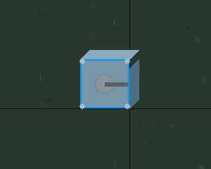

Противовоздушная батарея с детектором невидимок.

| ⚙️ Параметр | 📊 Значение |
|---|---|
| 💰 Стоимость | **120 титана** |
| ⏱️ Время стройки | **20 с** |
| ❤️ Прочность | **250 HP** |
| 📐 Размер | **1×1 тайл** |
| 💥 Урон | **30** (только воздух) |
| 🎯 Радиус | **256 px** |
| 🔍 Детектор | ✅ |

🧠 **Тактика** — турель плохо достаёт авиацию, ПВО вовсе не стреляет по земле. Смешивайте. Одна ПВО на базу полностью гасит ранние воздушные харасы.

---

### 🧱 Стена (Wall)

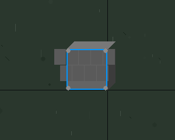

Дешёвая баррикада, чтобы направлять движение врага и выигрывать время.

| ⚙️ Параметр | 📊 Значение |
|---|---|
| 💰 Стоимость | **25 титана** |
| ⏱️ Время стройки | **5 с** |
| ❤️ Прочность | **500 HP** |
| 📐 Размер | **1×1 тайл** |

🧠 **Тактика** — стены не стреляют; стены заставляют врага **остановиться** там, где уже целятся ваши турели и бункеры. Перекройте узкий проход — и бой пойдёт на ваших условиях.

---

### 💣 Артиллерийский бункер (Artillery Bunker)

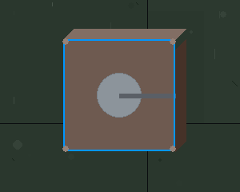

Дальнобойная гаубичная позиция с тяжёлым уроном за выстрел.

| ⚙️ Параметр | 📊 Значение |
|---|---|
| 💰 Стоимость | **250 титана + 50 плазмы** |
| ⏱️ Время стройки | **35 с** |
| ❤️ Прочность | **600 HP** |
| 📐 Размер | **2×2 тайла** |
| 💥 Урон | **40** |
| 🎯 Радиус | **384 px** (в 2 раза больше турели) |

🧠 **Тактика** — якорь статической обороны: спрячьте его за линией стен, чтобы пережил первый контакт, — а дальше работает дальность. Отлично прикрывает узкие коридоры карты.

---

### 🔵 Генератор щита (Shield Generator)

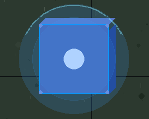

Проецирует восстанавливающийся барьер, принимающий урон до прочности.

| ⚙️ Параметр | 📊 Значение |
|---|---|
| 💰 Стоимость | **200 титана + 100 плазмы** |
| ⏱️ Время стройки | **40 с** |
| ❤️ Прочность | **500 HP** |
| 🛡️ Щит | **1000** (реген 10/с) |
| 📐 Размер | **2×2 тайла** |
| 📡 Радиус поля | **192 px** |

🧠 **Тактика** — множитель эффективного HP оборонительного узла. Ставьте по центру кластера турелей и бункеров, чтобы поле накрывало максимум построек, — щит бесплатно отрастает между боями.

---

## 🔬 Исследования

> ⚠️ **Примечание** — Арсенал и Инженерный корпус зарезервированы под будущую систему улучшений оружия и брони. Сегодня их стоит строить ради обзора и структуры базы; исследования появятся в одном из следующих обновлений.

### ⚒️ Арсенал (Armory)

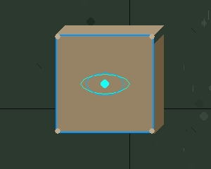

Центр исследований пехоты (будущие улучшения урона и брони).

| ⚙️ Параметр | 📊 Значение |
|---|---|
| 💰 Стоимость | **200 титана + 50 плазмы** |
| ⏱️ Время стройки | **30 с** |
| ❤️ Прочность | **600 HP** |
| 📐 Размер | **2×2 тайла** |

### 🔧 Инженерный корпус (Engineering Bay)

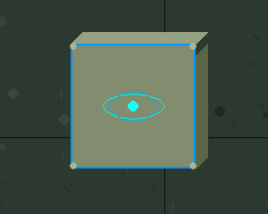

Центр исследований техники (будущие улучшения наземных машин).

| ⚙️ Параметр | 📊 Значение |
|---|---|
| 💰 Стоимость | **200 титана + 75 плазмы** |
| ⏱️ Время стройки | **30 с** |
| ❤️ Прочность | **600 HP** |
| 📐 Размер | **2×2 тайла** |

---

**[⬆ Наверх](#-содержание)** ·
[📖 README (RU)](README.ru.md) · [📖 README (EN)](README.md) ·
[🇷🇺 Русский](BUILDINGS_RU.md) | [🇬🇧 English](BUILDINGS_EN.md)

