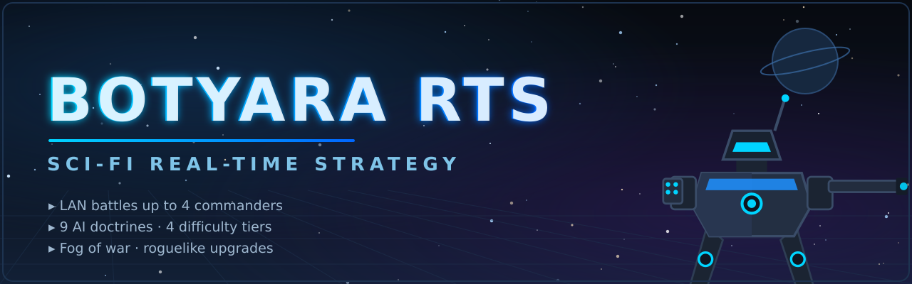

<div align="center">




**A feature-rich Sci-Fi Real-Time Strategy game built in pure Python + Pygame.**
Strategy-grade AI opponents, real LAN multiplayer with a lobby, fog of war, roguelike upgrades — no engine, no shortcuts.

</div>

---

## ✨ Features

### 🤖 Advanced AI Opponents
Bots that actually play the game — they build, expand, scout, defend, retreat and surrender:

- **4 difficulty tiers** — Novice, Soldier, Veteran, Nightmare: thinking speed, reaction time, mistakes, income handicap and squad discipline all scale
- **9 strategic doctrines** the bot commits to every match:
  `Balanced` · `Early Rush` · `Fortress Defense` · `Air Force` · `Economist` · `Swarm` · `Tech (SuperUnit)` · `Siege Push` · `Sabotage`
- **Full build orders** per doctrine, dynamic supply control, worker management, base-defense turrets
- **Army commander**: attack squads with triggers, retargeting, reinforcements, retreats on heavy losses, auto-siege artillery, harass raids on enemy workers
- **Bot surrender** — when a bot's position becomes hopeless it asks for mercy **once per match**: a panel appears top-center and *you* decide — accept victory or force it to fight to the bitter end (it goes all-in)
- The AI is fully **deterministic** (fixed sim ticks + seeded RNG), so the same brains fight in networked matches too

### 🌐 Real LAN Multiplayer
- **Lobby system** — host a game on a port, friends join by IP, pick colors, ready-up, chat
- **AI fill slots** — up to 4 commanders, any free slot can be a bot
- **Deterministic lockstep** — shared map seed + tick-stamped command relay; every client simulates the identical world
- **Desync detection** — periodic state hashes with an on-screen warning
- **In-game chat & pings**, pause votes, graceful disconnects
- Host controls match settings right in the lobby (map size, resources, density, AI difficulty)

### 🎛️ Match Setup Screen
Creating a battle is a real screen now: opponents (1–3 AI), AI difficulty, AI doctrine, map size (S/M/L), starting resources, resource density and map seed. Your last choices are remembered.

### ⚔️ RTS Core & Tactical Gameplay
- **Auto-Worker Economy** — starting workers auto-harvest the nearest Titan ore and Plasma geysers
- **Shift Command Queuing** — chain movement and attack orders by holding `Shift`
- **Multi-Selection** — box drag, `Shift + Click`, double-click to grab same-type units
- **Stances** — Aggressive / Defensive / Hold Position
- **Attack-Move** (`A`), stop (`S`), siege mode (`E`), control groups
- **Fair procedural maps** — 2–4 mirrored spawn positions, compact symmetric resource patches, paired plasma geysers, guaranteed base cluster, connectivity check
- **Animated loading screen** — terrain generation streams in chunks with live progress (no more frozen 20%)

### 🛠️ Roguelike Upgrade System
Every **3 minutes** — **3 tech cards** to pick from, **30 upgrades** across 3 tiers, up to 3 active, recycle for Titan.

### 🌫️ Fog of War & 🎨 Rendering
- Explored vs. visible vision grid; enemies hidden in the fog
- Procedural sci-fi art: slope-lit terrain, animated water with shore foam, faceted glowing crystals, steaming geysers, damage smoke & fire on wounded units, shield shimmer, team-colored wreckage
- `rendering/` package with per-category renderers + `RenderManager`

### 🎯 Tactical UI & Comms
- In-game chat (All/Allies), attention/retreat pings, interactive minimap, HP-bar modes, production bars

### 🌐 Full Localization
Complete **EN/RU** translation for everything — including AI doctrines, lobby, match setup and the surrender panel.

---

## 🌐 How to Play Online (LAN)

1. One player picks **Multiplayer → Host Game** (default port `5555`)
2. Host adds **AI slots** or waits for friends; guests pick **Join Game** and enter `host_ip:port`
3. Everyone readies up → host presses **START** → the match loads synchronously and begins on the same tick
4. All game commands (move/attack/build/produce/ping/chat) are relayed through the host with tick stamps — if states ever drift apart, a desync warning appears

> Same network or VPN (e.g. Tailscale/Hamachi) works. Port-forward `5555` if hosting across networks.

---

## 🎮 Controls & Shortcuts

| Action | Control |
| :--- | :--- |
| **Move / Attack Target / Rally** | `Right Click` |
| **Select Unit / Box Drag** | `Left Click` |
| **Multi-Select Add / Queue Commands** | `Shift + Click` |
| **Attack-Move** | `A + Left Click` |
| **Stop / Hold / Stance / Siege** | `S` / `H` / `T` / `E` |
| **Control Groups** | `Ctrl + 1..9` (assign), `1..9` (select) |
| **Ping the map** | `Left Alt + Click` |
| **Camera** | `WASD` / Arrows / Edge Scroll / MMB Drag / Wheel |
| **Toggle Grid / HP Bars** | `G` / `Left Alt` |
| **Pause** | `ESC` |

---

## 📦 Installation & Running

```bash
git clone https://github.com/dimasbotyara/botyaraRTS.git
cd botyaraRTS

python -m venv .venv
source .venv/bin/activate     # Linux/macOS
# .venv\Scripts\activate      # Windows

pip install -r requirements.txt
python main.py
```

---

## 🧪 Running Tests

The project ships a pytest suite (55 tests, headless):

```bash
pip install -r requirements-dev.txt
pytest tests/
```

Covered: map generation (determinism, symmetry, connectivity), network protocol codecs, command application, economy & refunds, pathfinding, AI configs/strategies/surrender, localization parity, and a full headless match-load-and-simulate smoke test.

---

## 🏗️ Architecture

```
botyaraRTS/
├── main.py                 # Entry point, display init, window icon
├── settings.py             # Constants, match presets, JSON settings
├── localization.py         # EN/RU translation dictionary
│
├── ai/                     # Strategy-driven AI opponents
│   ├── brain.py            # Orchestrator (one per AI player)
│   ├── config.py           # Difficulty profiles
│   ├── strategies.py       # 9 doctrines with build orders
│   ├── macro.py            # Economy, build order, placement search
│   ├── commander.py        # Squads, attacks, defense, harass
│   └── surrender.py        # Hopelessness evaluator
│
├── core/                   # Engine-level systems
│   ├── game.py             # States, incremental loading, lockstep sim
│   ├── camera.py / tilemap.py / pathfinding.py
│   ├── fog_of_war.py / minimap.py / spatial_hash.py
│
├── network/                # LAN multiplayer
│   ├── protocol.py         # Packet codec + command factories
│   ├── server.py           # Lobby phase + relay phase
│   ├── client.py           # Connection + receive thread
│   ├── session.py          # Host/Remote session abstraction
│   └── commands.py         # Command apply/route + state hash
│
├── entities/               # Units & buildings (infantry/vehicles/aircraft/specials)
├── systems/                # Selection, commands, economy, combat, upgrades
├── rendering/              # Procedural renderers + detail FX
├── ui/                     # HUD, widgets, chat, pings, upgrade picker
├── tests/                  # pytest suite (headless)
├── assets/
│   ├── branding/           # Banners & icon (SVG + PNG)
│   ├── fonts/              # Roboto
│   └── sounds/             # SFX + victory/defeat music
└── data/settings.json      # Persisted user config
```

---

## 🛠️ Tech Stack

| Layer | Technology |
|---|---|
| **Language** | Python 3.9+ |
| **Engine** | Pygame 2.6 |
| **Multiplayer** | Deterministic lockstep over TCP (custom protocol) |
| **AI** | Utility/plan hybrid, deterministic on sim ticks |
| **Pathfinding** | Custom A* with ramp/height rules |
| **Perf** | Spatial hashing, chunked pre-generation |
| **Tests** | pytest, headless (SDL dummy driver) |

Zero external runtime dependencies beyond `pygame`.

---

## 🔧 Customization

- **New AI doctrine** — add an entry to `ai/strategies.py` (build order + army composition) and one localization key pair
- **New difficulty** — add a profile to `ai/config.py`
- **New upgrade card / unit / building** — `systems/upgrades.py` / `entities/` + register a renderer
- **Balance & presets** — `settings.py` (`MATCH_SIZES`, `MATCH_START_RESOURCES`, `MATCH_DENSITY`)

---

## 🚧 Roadmap

- ✅ Strategy AI with difficulties, doctrines and surrender
- ✅ Real LAN multiplayer with lobby and lockstep
- ✅ Match setup screen
- ⬜ Replays (determinism already there!)
- ⬜ Campaign mode
- ⬜ Ranked ladders / ELO

---

## ⚠️ Disclaimer

This is a hobby project. It's not trying to compete with StarCraft — it's trying to prove that you can build a real RTS in Python with Pygame. And it kind of does.

---

## 📜 License

MIT — see [LICENSE](LICENSE) for details.

---

## 👤 Author

**dimasbotyara** — [@dimasbotyara](https://github.com/dimasbotyara)

Made with 🚀, ☕, and a lot of `pygame.draw.*`.

<div align="center">

**If you like it, drop a ⭐ — it fuels the next 10,000 lines**

</div>
