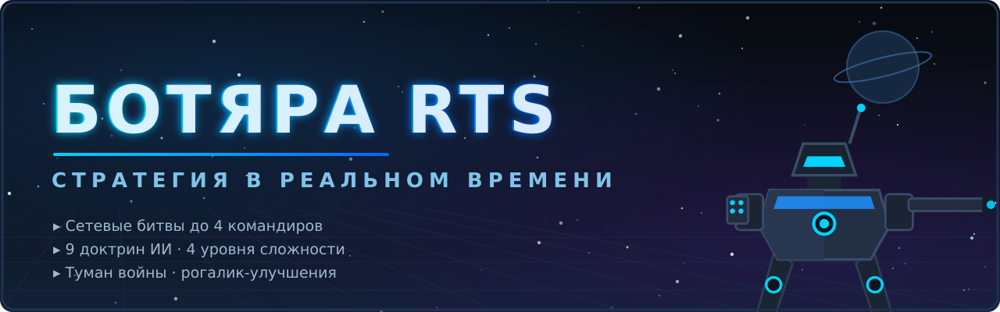
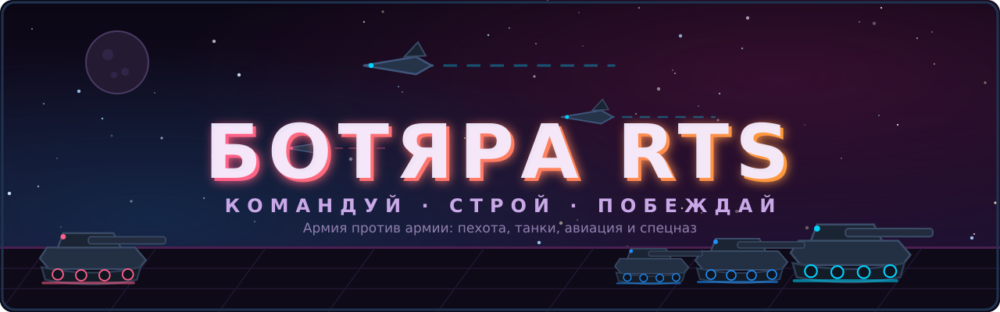
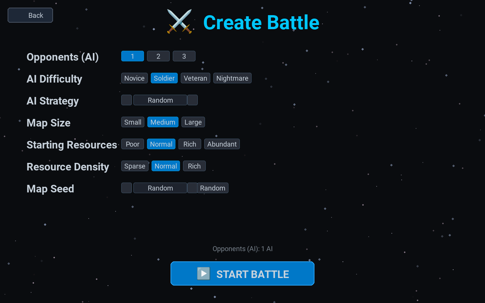
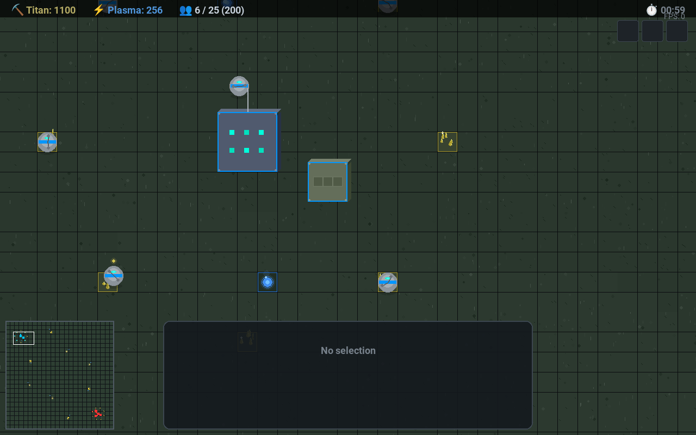
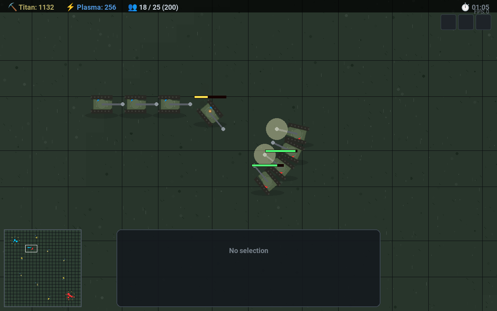
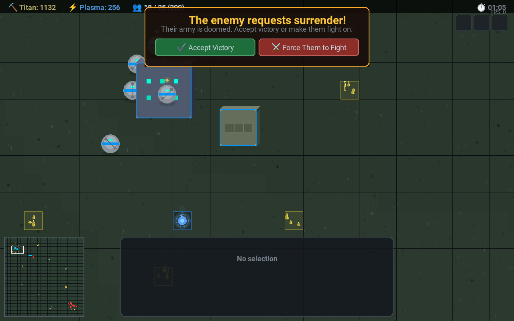
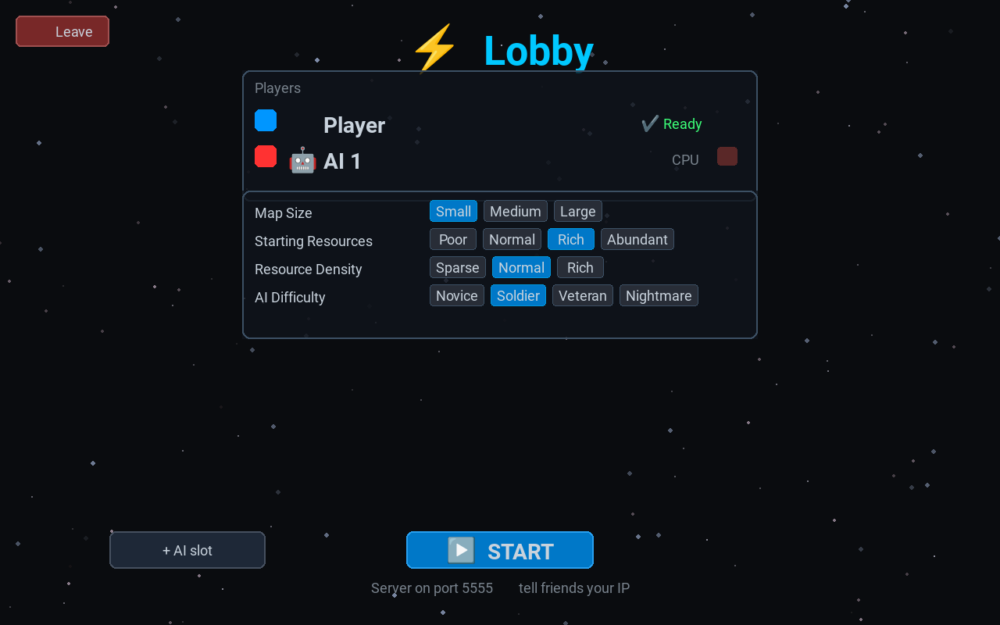
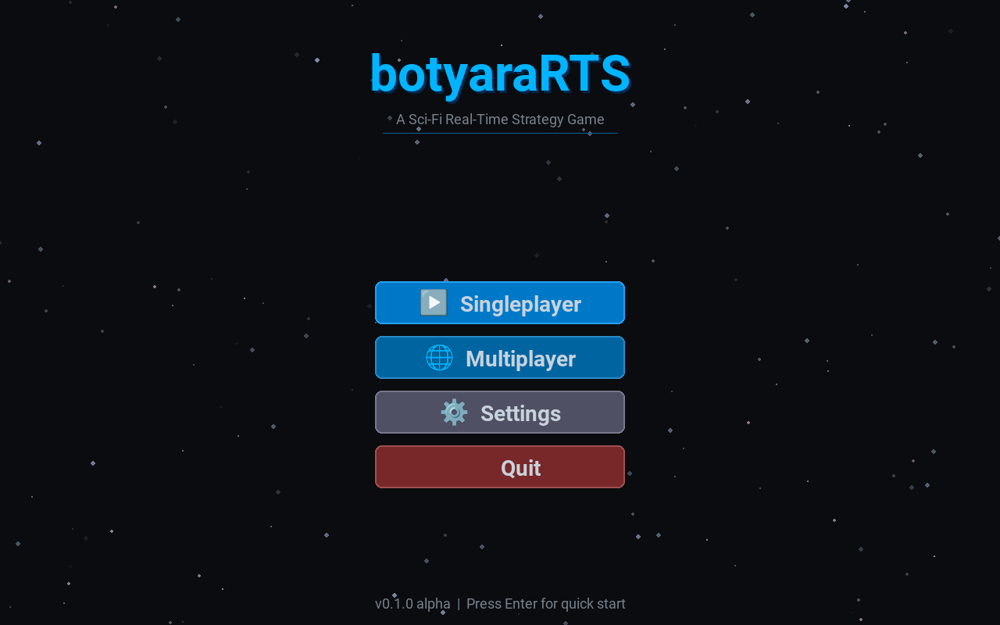
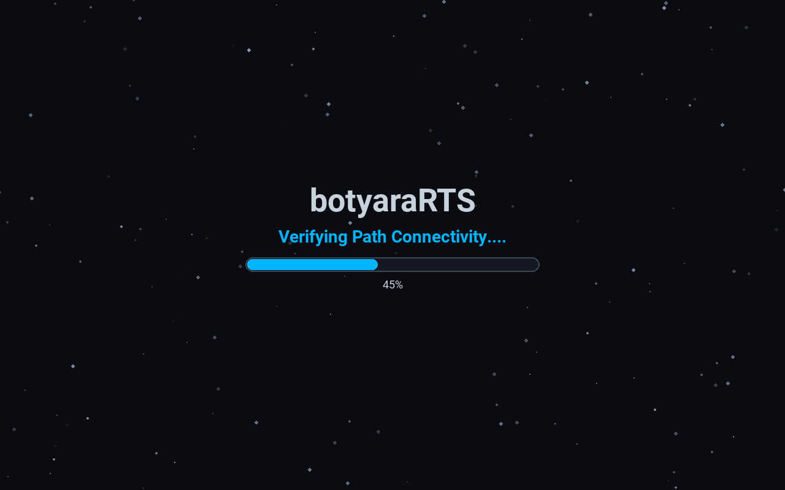

<div align="center">



[🇬🇧 English](README.md) | [🇷🇺 Русский](README.ru.md)


**Научно-фантастическая стратегия в реальном времени на чистом Python + Pygame.**
ИИ-противники уровня стратегии, настоящий LAN-мультиплеер с лобби, туман войны, рогалик-улучшения — без движка и компромиссов.

</div>

<div align="center">

</div>

---

## ✨ Возможности

### 🤖 Продвинутый ИИ
Боты, которые реально играют: строятся, расширяются, разведывают, обороняются, отступают и **сдаются**:

- **4 уровня сложности** — Новобранец, Солдат, Ветеран, Кошмар: скорость мышления, время реакции, шанс ошибок, надбавка к добыче и дисциплина отрядов
- **9 боевых доктрин**, которым бот следует весь матч:
  `Сбалансированный` · `Ранняя атака` · `Оборона` · `Только авиация` · `Экономист` · `Рой` · `Технарь` · `Осада` · `Диверсии`
- **Полные билд-ордера** под каждую доктрину, контроль населения, менеджмент рабочих, оборонительные турели
- **Командир армии**: атакующие отряды с триггерами, перенацеливание, подкрепления, отступления при тяжёлых потерях, авто-осада артиллерии, рейды по шахтёрам
- **Сдача бота** — когда положение становится безнадёжным, бот просит о капитуляции **один раз за матч**: сверху появляется панель, и *вы* решаете — принять победу или заставить его драться до конца (тогда он идёт ва-банк)
- ИИ полностью **детерминирован** (фиксированные тики симуляции + сидированный RNG), поэтому те же мозги воюют и в сетевых матчах

### 🌐 Настоящий мультиплеер по LAN
- **Система лобби** — хост создаёт игру на порту, друзья подключаются по IP, выбирают цвет, готовятся, общаются в чате
- **Слоты с ИИ** — до 4 командиров, любой свободный слот можно отдать боту
- **Детерминированный локстеп** — общий seed карты + команды с тиковыми штампами; каждый клиент просчитывает идентичный мир
- **Детект рассинхрона** — периодические хэши состояния и предупреждение на экране
- **Чат и пинги в игре**, голосование за паузу, аккуратная обработка выходов
- Хост настраивает матч прямо в лобби (размер карты, ресурсы, плотность, сложность ИИ)

### 🎛️ Экран создания матча
Создание битвы — это полноценный экран: противники (1–3 ИИ), сложность ИИ, доктрина ИИ, размер карты (S/M/L), стартовые ресурсы, плотность ресурсов и seed. Последний выбор запоминается.

<div align="center">

</div>

### 🖼️ Скриншоты

<div align="center">
<table>
<tr>
<td align="center"><b>База и добыча</b><br/></td>
<td align="center"><b>Танковый бой</b><br/></td>
</tr>
<tr>
<td align="center"><b>Сдача противника</b><br/></td>
<td align="center"><b>Сетевое лобби</b><br/></td>
</tr>
<tr>
<td align="center"><b>Главное меню</b><br/></td>
<td align="center"><b>Загрузка матча</b><br/></td>
</tr>
</table>
</div>

### ⚔️ Ядро RTS и тактика
- **Экономика с авто-рабочими** — стартовые рабочие сразу идут добывать титан и плазму
- **Очереди команд на Shift** — цепочки движения и атак
- **Мультивыделение** — рамкой, `Shift + клик`, двойной клик по юниту своего типа
- **Стойки** — Агрессивная / Оборонительная / Держать позицию
- **Attack-Move** (`A`), стоп (`S`), осадный режим (`E`), группы управления
- **Честные процедурные карты** — 2–4 зеркальных спавна, компактные симметричные патчи ресурсов, пары гейзеров, гарантированная база, проверка связности
- **Анимированная загрузка** — генерация ландшафта течёт чанками с живым прогрессом (никаких зависаний на 20%)

### 🛠️ Рогалик-улучшения
Каждые **3 минуты** — **3 карточки** на выбор, **30 улучшений** в 3 тирах, до 3 активных, переработка в титан.

### 🌫️ Туман войны и 🎨 графика
- Сетка обзора «исследовано / видно сейчас»; ландшафт карты открыт с самого старта — никакого чёрного экрана на отсчёте, враги прячутся только вне зоны обзора
- Процедурный sci-fi арт: рельефное освещение, анимированная вода с пеной, гранёные светящиеся кристаллы, парящие гейзеры, дым и огонь на повреждённых юнитах, свечение щитов, обломки в цвете команды
- Пакет `rendering/` с рендерерами по категориям + `RenderManager`

### 🎯 Тактический UI и связь
- Чат в игре (Все/Союзники), пинги «внимание/отступление», интерактивная миникарта, режимы полосок HP, полоски производства

### 🌐 Полная локализация
Полный перевод **EN/RU** всего — включая доктрины ИИ, лобби, экран создания матча и панель сдачи.

---

## 🌐 Как играть по сети (LAN)

1. Один игрок выбирает **Мультиплеер → Создать игру** (порт по умолчанию `5555`)
2. Хост добавляет **слоты с ИИ** или ждёт друзей; гости выбирают **Подключиться** и вводят `ip_хоста:порт`
3. Все «готовятся» → хост жмёт **СТАРТ** → матч грузится синхронно и начинается на одном тике у всех
4. Все игровые команды (движение/атака/стройка/производство/пинг/чат) идут через хоста с тиковыми штампами — если состояния разойдутся, появится предупреждение о рассинхроне

> Подходит одна сеть или VPN (Tailscale/Hamachi). Для игры через интернет пробросьте порт `5555`.

---

## 🎮 Управление

| Действие | Управление |
| :--- | :--- |
| **Движение / Атака цели / Точка сбора** | `ПКМ` |
| **Выделение юнита / рамкой** | `ЛКМ` |
| **Добавить в выделение / очередь команд** | `Shift + клик` |
| **Attack-Move** | `A + ЛКМ` |
| **Стоп / Держать / Стойка / Осада** | `S` / `H` / `T` / `E` |
| **Группы управления** | `Ctrl + 1..9` (задать), `1..9` (выбрать) |
| **Пинг по карте** | `Left Alt + клик` |
| **Камера** | `WASD` / Стрелки / край экрана / зажатое колесо / колесо |
| **Сетка / Полоски HP** | `G` / `Left Alt` |
| **Пауза** | `ESC` |

---

## 📦 Установка и запуск

```bash
git clone https://github.com/dimasbotyara/botyaraRTS.git
cd botyaraRTS

python -m venv .venv
source .venv/bin/activate     # Linux/macOS
# .venv\Scripts\activate      # Windows

pip install -r requirements.txt
python main.py
```

---

## 🧪 Запуск тестов

В проекте есть набор pytest (55 тестов, headless):

```bash
pip install -r requirements-dev.txt
pytest tests/
```

Покрыто: генерация карт (детерминизм, симметрия, связность), кодеки сетевого протокола, применение команд, экономика и возвраты, поиск пути, конфиги/стратегии/сдача ИИ, парность локализации и полный дымовой тест «загрузка матча + симуляция».

---

## 🏗️ Архитектура

```
botyaraRTS/
├── main.py                 # Точка входа, окно, иконка
├── settings.py             # Константы, пресеты матчей, JSON-настройки
├── localization.py         # Словарь переводов EN/RU
│
├── ai/                     # ИИ-противники на основе стратегий
│   ├── brain.py            # Оркестратор (по одному на ИИ-игрока)
│   ├── config.py           # Профили сложности
│   ├── strategies.py       # 9 доктрин с билд-ордерами
│   ├── macro.py            # Экономика, билд-ордер, поиск мест
│   ├── commander.py        # Отряды, атаки, оборона, диверсии
│   └── surrender.py        # Оценщик безнадёжности
│
├── core/                   # Движковые системы
│   ├── game.py             # Состояния, инкрементальная загрузка, локстеп-сим
│   ├── camera.py / tilemap.py / pathfinding.py
│   ├── fog_of_war.py / minimap.py / spatial_hash.py
│
├── network/                # Мультиплеер по LAN
│   ├── protocol.py         # Кодек пакетов + фабрики команд
│   ├── server.py           # Фаза лобби + фаза релея
│   ├── client.py           # Подключение + поток приёма
│   ├── session.py          # Абстракция хост/клиент сессий
│   └── commands.py         # Применение/маршрут команд + хэш состояния
│
├── entities/               # Юниты и здания (пехота/техника/авиация/спецназ)
├── systems/                # Выделение, команды, экономика, бои, улучшения
├── rendering/              # Процедурные рендереры + эффекты
├── ui/                     # HUD, виджеты, чат, пинги, выбор улучшений
├── tests/                  # Набор pytest (headless)
├── assets/
│   ├── branding/           # Баннеры и иконка (SVG + PNG)
│   ├── fonts/              # Roboto
│   └── sounds/             # SFX + музыка победы/поражения
└── data/settings.json      # Сохранённая конфигурация
```

---

## 🛠️ Технологии

| Слой | Технология |
|---|---|
| **Язык** | Python 3.9+ |
| **Движок** | Pygame 2.6 |
| **Мультиплеер** | Детерминированный локстеп поверх TCP (свой протокол) |
| **ИИ** | Гибрид правил и планирования, детерминирован на тиках симуляции |
| **Поиск пути** | Свой A* с правилами рамп и высот |
| **Производительность** | Пространственный хеш, чанковая предгенерация |
| **Тесты** | pytest, headless (SDL dummy driver) |

Ноль внешних зависимостей, кроме `pygame`.

---

## 🔧 Настройка

- **Новая доктрина ИИ** — добавьте запись в `ai/strategies.py` (билд-ордер + состав армии) и пару ключей локализации
- **Новая сложность** — профиль в `ai/config.py`
- **Новая карточка улучшения / юнит / здание** — `systems/upgrades.py` / `entities/` + регистрация рендерера
- **Баланс и пресеты** — `settings.py` (`MATCH_SIZES`, `MATCH_START_RESOURCES`, `MATCH_DENSITY`)

---

## 📚 Справочники

- 🏗️ [Здания (RU)](BUILDINGS_RU.md) — характеристики, производство и тактика каждой постройки
- 🏗️ [Buildings (EN)](BUILDINGS_EN.md) — то же на английском

---

## 🚧 Дорожная карта

- ✅ Стратегический ИИ со сложностями, доктринами и сдачей
- ✅ Настоящий LAN-мультиплеер с лобби и локстепом
- ✅ Экран создания матча
- ⬜ Реплеи (детерминизм уже есть!)
- ⬜ Кампания
- ⬜ Рейтинговые матчи / ELO

---

## ⚠️ Дисклеймер

Это хобби-проект. Он не пытается конкурировать со StarCraft — он пытается доказать, что настоящую RTS можно написать на Python + Pygame. И вроде бы доказывает.

---

## 📜 Лицензия

MIT — подробности в [LICENSE](LICENSE).

---

## 👤 Автор

**dimasbotyara** — [@dimasbotyara](https://github.com/dimasbotyara)

Сделано с 🚀, ☕ и большим количеством `pygame.draw.*`.

<div align="center">

**Понравилось? Поставь ⭐ — это топливо для следующих 10 000 строк**

</div>
